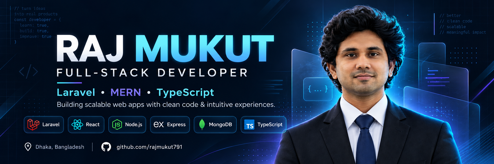

  

**FULL-STACK DEVELOPER**

Dhaka, Bangladesh &nbsp; / &nbsp; CSE Graduate

 

&nbsp;

  

Clean interfaces &nbsp; · &nbsp; Reliable systems &nbsp; · &nbsp; Practical solutions

 

## Selected Work

<table>
<tr>
<td colspan="2" valign="top">

01 &nbsp; / &nbsp; FEATURED PROJECT

### 🎓 NUB Connect

**One community. More connections.**

A university platform connecting students, alumni and mentors.

`MongoDB` &nbsp; `Express.js` &nbsp; `React` &nbsp; `Node.js`

</td>
</tr>
<tr>
<td width="50%" valign="top">

02 &nbsp; / &nbsp; PUBLIC REPORTING

### 🛡️ Nirbhoy Bangladesh

Evidence management, report tracking and verification.

`Laravel` &nbsp; `Livewire` &nbsp; `MySQL`

</td>
<td width="50%" valign="top">

03 &nbsp; / &nbsp; HEALTHCARE

### 🩺 MedhBook

Appointments and secure medical record access.

`React` &nbsp; `Node.js` &nbsp; `MongoDB`

</td>
</tr>
</table>

 

## Tools Behind the Work

 

  

  

---

 

[**Explore my repositories ↗**](https://github.com/rajmukut1628?tab=repositories)

 

